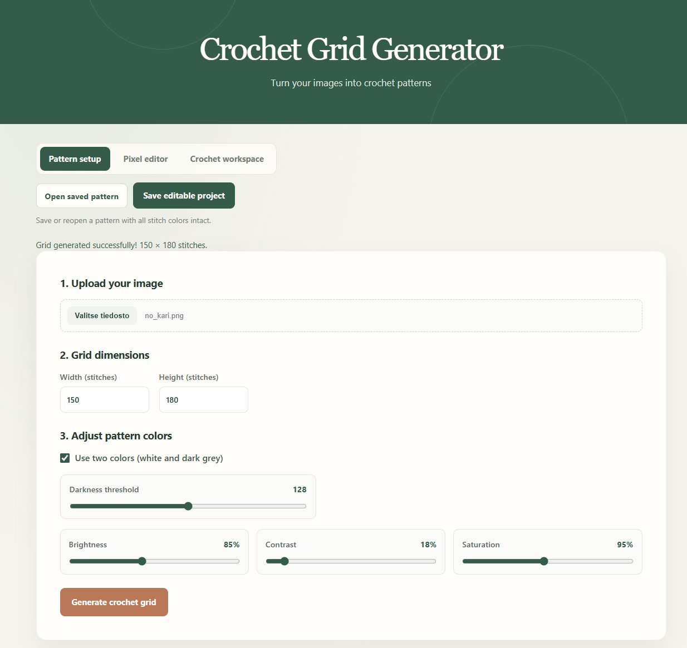
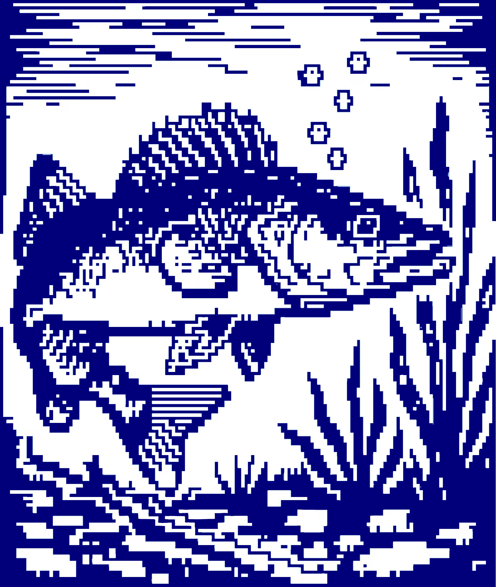
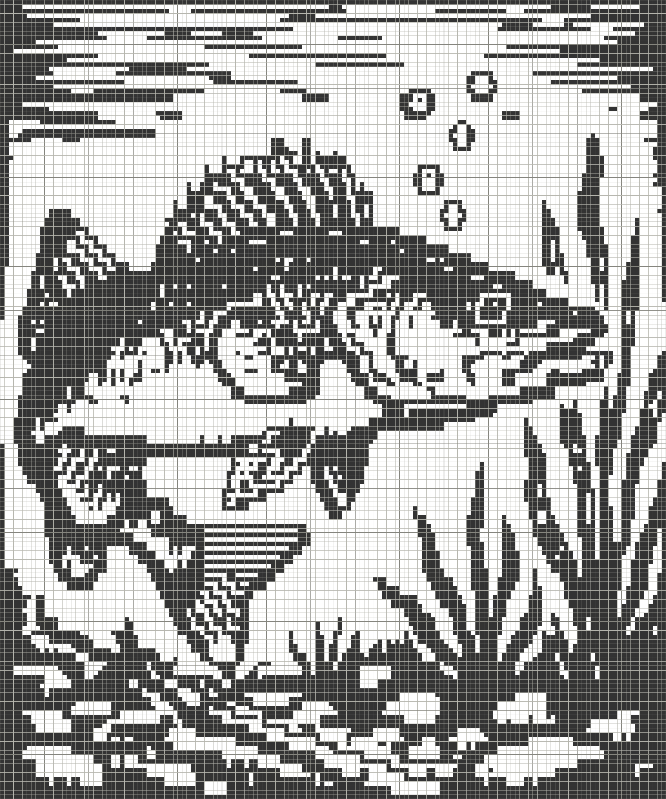
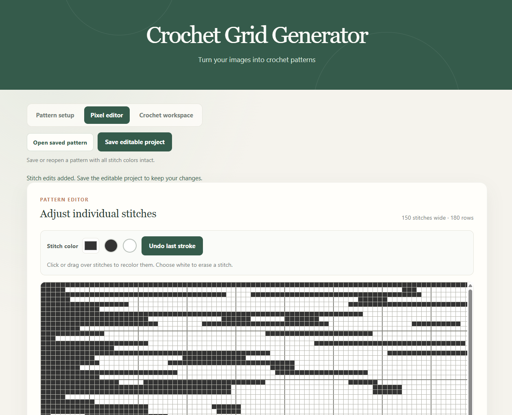
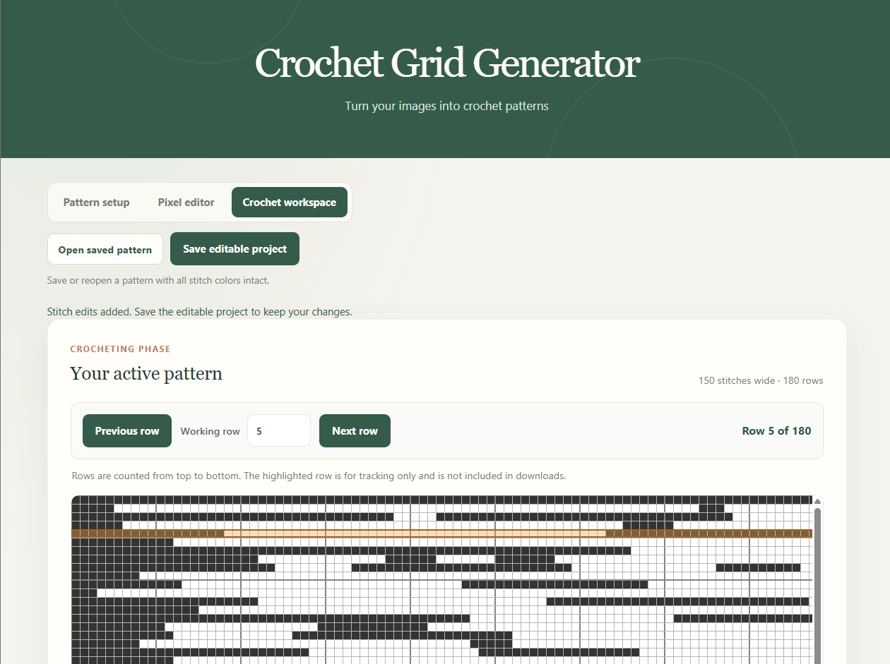

# Crochet Grid Tool

Crochet Grid Tool turns an image into a stitch-by-stitch chart. Generate a pattern, fine-tune individual stitches, save an editable project, and track your current row while you crochet.

## Features

- Convert PNG, JPEG, or WebP images into a crochet grid.
- Set the pattern width and height from 1 to 300 stitches.
- Prevent maximal vertical runs of exactly 2 same-color stitches without changing the chosen grid dimensions; horizontal matches and vertical runs taller than 2 are allowed. In two-color mode, corrections use only white and dark grey.
- Adjust brightness, contrast, saturation, and two-color settings from the pixel editor.
- Optionally simplify the image to white and dark grey, with an adjustable darkness threshold.
- View generated charts in an expanded, scrollable preview.
- Read row and column coordinates in the pattern setup, pixel editor, and crochet workspace; ruler ticks mark each stitch, with labels at stitch 1 and every 10 stitches.
- Preview the chart at a larger size and download it as a PNG.
- Recolor individual stitches in the pixel editor. Click or drag to paint; use white to erase.
- Undo the most recent paint stroke.
- Toggle the generated pattern into a mosaic-crochet pattern with alternating yarn rows and dropped-stitch marks.
- Track the row you are working on in a separate crochet workspace with a large, scrollable pattern canvas.
- Save and reopen an editable project containing the stitch colors, dimensions, color settings, and current row.

## Getting started

No installation or build step is required.

1. Download or clone this repository.
2. Open `index.html` in a modern browser.
3. Upload a PNG, JPEG, or WebP image and generate a pattern.

The app is a static website and processes the selected image in your browser.

## How to use

### Create a pattern

1. In **Pattern setup**, choose an image.
2. Set the desired pattern width and height in stitches.
3. Select **Generate crochet grid**. The generated grid always retains the requested width and height. A maximal vertical run of the same color exactly 2 stitches tall is corrected, even if it is connected horizontally to other stitches. Side-by-side matches and vertical runs taller than 2 remain unchanged; the tool reports the number of changed stitches.
4. Open **Pixel editor** to adjust brightness, contrast, and saturation. Enable **Use two colors (white and dark grey)** for a two-color chart; adjust **Darkness threshold** to change which stitches are classified as dark. These settings regenerate the pattern until you paint stitches. After painting, generating again applies changed settings and replaces manual edits.

The pattern setup canvas is scrollable for inspecting wide or tall charts. Select **Download PNG** to save an image of the pattern, including its grid lines.

Example input and generated chart:

<table>
  <tr>
    <th>Original image</th>
    <th>Generated crochet pattern</th>
  </tr>
  <tr>
    <td></td>
    <td></td>
  </tr>
</table>

### Edit individual stitches

1. Generate a pattern or open a saved project.
2. Open **Pixel editor**.
3. Choose a color using the color picker, or select the dark-grey or white swatch.
4. Click or drag across stitches to apply the selected color. White can be used to replace a stitch with the background color.
5. Select **Undo last stroke** or press **Ctrl+Z** to revert the most recent click or drag. On macOS, use **Command+Z**. The shortcut is active in the pixel editor and does not override undo in text fields.

Edits update the pattern and crochet workspace. Red highlights mark vertical same-color runs exactly 2 stitches tall created by edits; these warnings are visual only and do not recolor the pattern. Generating the pattern again from the source image replaces existing stitch edits.

To compare stitch placement with the source, enable **Show original image guide**. Choose whether it appears on top of or underneath the stitches, then adjust its opacity. The guide is a visual aid only and does not change stitch colors.

In **Pattern setup**, turn on **Use mosaic crochet rules** beside the generated pattern to convert that same displayed pattern into mosaic placement. It is not a second chart: the toggle changes the pattern shown in the preview and crochet workspace, and **Download PNG** exports whichever mode is active. The pixel editor continues to edit the underlying stitch colors; those edits are reflected when mosaic mode is enabled.

Mosaic mode converts the edited pixels to dark grey and white using the darkness threshold, then lays out alternating-color rows with two setup rows, border stitches, and a final row for dropped stitches. X marks indicate DCs into the matching-color front loop two rows below. Work unmarked stitches as SC BLO, work both loops at the first and last stitch, and follow the right-side-only, no-turn method: fasten off at each row end and return to the starting side. The crochet workspace row tracker follows the expanded mosaic pattern while this mode is on.

### Track crochet progress

Open **Crochet workspace** to follow the chart while crocheting. The pattern canvas uses the same large, scrollable display as the pixel editor; scroll within it to inspect different parts of wide or tall patterns. Use the coordinate rulers to locate stitches: columns count left to right and rows top to bottom, both starting at 1. Every stitch has a tick, with numbers at stitch 1 and each 10th stitch. Use **Previous row**, **Next row**, or the **Working row** field to move the highlight.

The row highlight is a temporary guide and is not included in the downloaded PNG.

### Save and reopen a project

Select **Save editable project** to download a `.json` file. To continue later, open the tool and select **Open saved pattern**, then choose that project file. The saved project restores the stitch colors, dimensions, color settings, current row, and a resized copy of the source image for the pixel-editor guide.

Use the PNG download for viewing or printing. Use the JSON project to continue editing or crocheting later.

## Project files

- `index.html` — application structure and workflow views.
- `style.css` — layout and visual styling.
- `script.js` — application behavior and coordination.
- `image-processing.js` — image color adjustments and two-color conversion.
- `grid-renderer.js` — stitch grids, grid lines, coordinate rulers, and row highlights.
- `stitch-pattern-rules.js` — detects and corrects vertically stacked same-color stitches.
- `pixel-editor.js` — stitch painting and undo behavior.
- `pattern-project.js` — editable project serialization and validation.
- `mosaic-pattern.js` — mosaic pattern conversion and rendering.
- `assets/` — project assets.

## License

This project is released under the [MIT License](./LICENSE).
